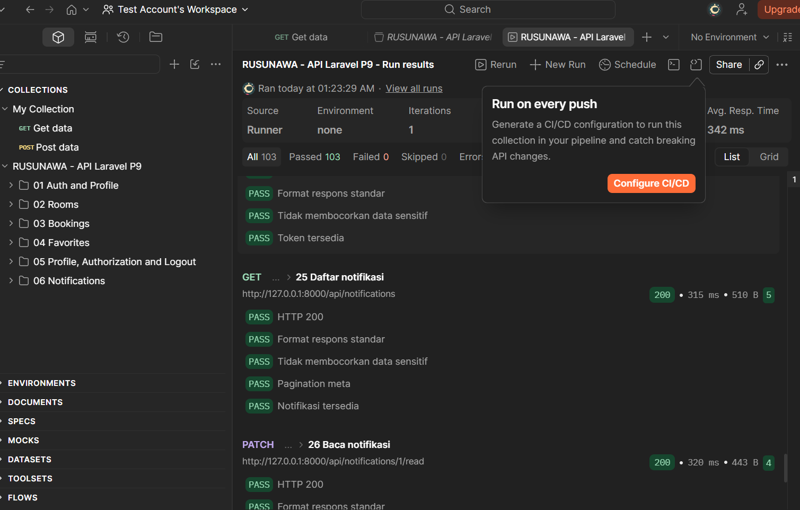
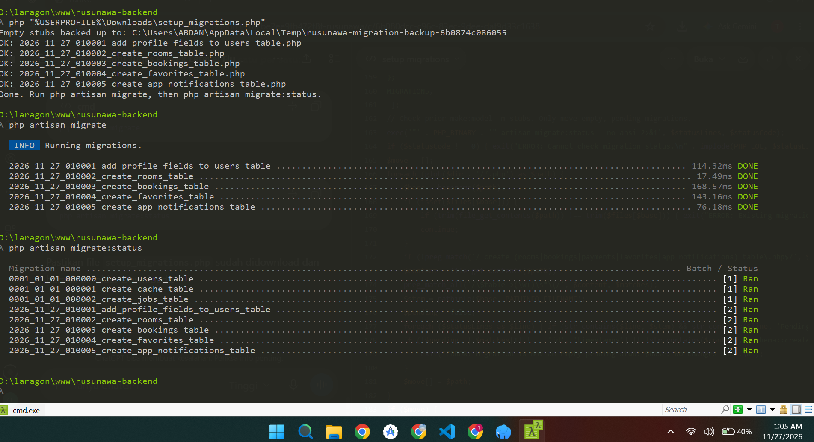
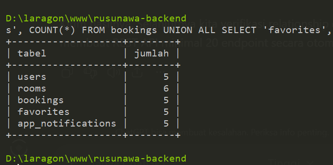

# Hasil Pengujian Backend RUSUNAWA — Pertemuan 9

- Kelompok: Grup E-PJBL
- Tanggal: 27 November 2026 (WIB), sekitar pukul 01.23
- Lingkungan: Laravel 12.74.0, PHP 8.3.37, MySQL Laragon, Sanctum 4.5.0
- Base URL: `http://127.0.0.1:8000/api`
- Collection: [RUSUNAWA.postman_collection.json](postman/RUSUNAWA.postman_collection.json)

## Ringkasan pengujian

| Indikator | Hasil |
|---|---:|
| Route API terdaftar | 21 |
| Request dalam collection | 28 |
| Assertion lulus | 103 |
| Assertion gagal | 0 |
| Assertion dilewati | 0 |
| Rata-rata waktu respons | 342 ms |

Hasil agregat bersumber dari screenshot Postman Runner. Rincian berikut diturunkan dari skrip assertion collection yang dijalankan; bukan ekspor respons mentah per request.

## Skenario Postman

| Skenario | Endpoint | HTTP yang diuji | Assertion | Hasil |
|---|---|---:|---:|---|
| 01 Register valid | `POST /api/register` | 201 | 4 | PASS |
| 02 Login valid | `POST /api/login` | 200 | 4 | PASS |
| 03 Login tidak valid | `POST /api/login` | 422 | 4 | PASS |
| 04 Profil tanpa token | `GET /api/profile` | 401 | 3 | PASS |
| 05 Profil dengan token | `GET /api/profile` | 200 | 4 | PASS |
| 06 Daftar kamar | `GET /api/rooms?per_page=20` | 200 | 5 | PASS |
| 07 Detail kamar | `GET /api/rooms/A101` | 200 | 4 | PASS |
| 08 Kamar tidak ditemukan | `GET /api/rooms/TIDAK-ADA-POSTMAN` | 404 | 3 | PASS |
| 09 Pemesanan tidak valid | `POST /api/bookings` | 422 | 4 | PASS |
| 10 Pemesanan valid | `POST /api/bookings` | 201 | 4 | PASS |
| 11 Daftar pemesanan | `GET /api/bookings` | 200 | 4 | PASS |
| 12 Detail pemesanan | `GET /api/bookings/{{booking_id}}` | 200 | 4 | PASS |
| 13 Batalkan pemesanan | `PATCH /api/bookings/{{booking_id}}/cancel` | 200 | 4 | PASS |
| 14 Tambah favorit | `POST /api/favorites` | 201 | 3 | PASS |
| 15 Daftar favorit | `GET /api/favorites` | 200 | 5 | PASS |
| 16 Hapus favorit | `DELETE /api/favorites/A101` | 200 | 3 | PASS |
| 17 Ubah profil | `PUT /api/profile` | 200 | 4 | PASS |
| 18 Ubah password | `PUT /api/profile/password` | 200 | 3 | PASS |
| 19 Tambah kamar ditolak untuk student | `POST /api/rooms` | 403 | 3 | PASS |
| 20 Ubah kamar ditolak untuk student | `PUT /api/rooms/A101` | 403 | 3 | PASS |
| 21 Hapus kamar ditolak untuk student | `DELETE /api/rooms/A101` | 403 | 3 | PASS |
| 22 Logout akun baru | `POST /api/logout` | 200 | 3 | PASS |
| 23 Token setelah logout ditolak | `GET /api/profile` | 401 | 3 | PASS |
| 24 Login akun seeder untuk notifikasi | `POST /api/login` | 200 | 4 | PASS |
| 25 Daftar notifikasi | `GET /api/notifications` | 200 | 5 | PASS |
| 26 Baca notifikasi | `PATCH /api/notifications/{{notification_id}}/read` | 200 | 4 | PASS |
| 27 Baca semua notifikasi | `PATCH /api/notifications/read-all` | 200 | 3 | PASS |
| 28 Logout akun seeder | `POST /api/logout` | 200 | 3 | PASS |

## Verifikasi lapisan database

- Migration: seluruh migration awal dan tabel domain berstatus Ran; migration token Sanctum kemudian juga berhasil berdasarkan terminal.
- Relationship Tinker: Booking → User dan Room; User → Bookings; Room → Bookings, seluruhnya mengembalikan data tanpa error.
- Seeder sebelum pengujian: users 5, rooms 6, bookings 5, favorites 5, app_notifications 5.
- Format respons: assertion memeriksa `status`, `message`, `data`, serta `meta` pada endpoint berpagination.
- Keamanan: assertion memeriksa ketiadaan field `password`, `remember_token`, `password_confirmation` di dalam `data`.

## Bukti screenshot

### Hasil Postman Runner

### Migration

### Seeder

## Batasan dan tindak lanjut

- Endpoint POST, PUT, DELETE kamar diuji untuk penolakan akses mahasiswa (403); keberhasilan CRUD dengan akun admin belum diuji.
- Screenshot Postman dipotong untuk menghilangkan panel chat yang tidak relevan. Bukti tambahan per skenario dapat ditambahkan dari Runner tanpa menampilkan token atau kredensial.
- Integrasi Flutter dan pengujian end-to-end merupakan pekerjaan Pertemuan 10 dan tidak diklaim selesai di sini.
